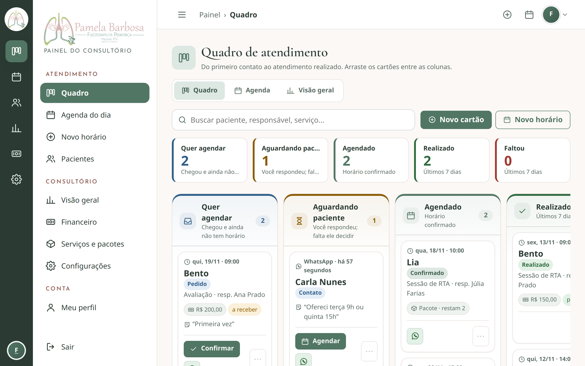
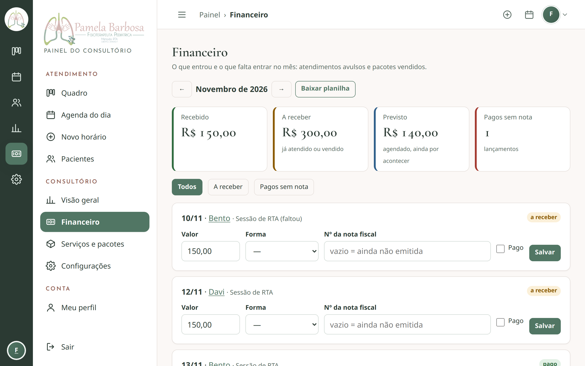

# Ruah

[](https://github.com/Amadeus-22/ruah/actions/workflows/ci.yml)


[](LICENSE)

Scheduling, patient triage and bookkeeping for a physiotherapist who works alone.
It runs in production for a real respiratory physiotherapy practice.

*Ruah* (רוּחַ) is the Hebrew word for breath, as in Genesis 2:7.



## The problem

With no receptionist, every booking arrives by WhatsApp or Instagram. Requests
get lost in chats, the same slot is offered twice, package sessions are counted
from memory, and at the end of the month nobody knows what was paid or which
payments still need an invoice.

Ruah is the professional's private panel for all of that. Patients do not log
in or book online: the professional records each contact and appointment
herself, and the root URL opens the login.

The interface is in Brazilian Portuguese, the language of its user. Code
comments that describe business rules are in Portuguese for the same reason.

## Features

| Area | What it does |
|---|---|
| Triage board | Five columns: wants to book, waiting for the patient, booked, done, no-show. Cards move by drag and drop or with buttons, so it works on a phone. Each contact keeps notes and a history. |
| Day agenda | Next eight days, sessions that passed without an outcome, packages about to run out, reminders to send. |
| Reminders | One tap opens WhatsApp with the message written; the reminder then leaves the list. |
| Packages | Sells a block of sessions and deducts them as they are used. Whether a no-show costs a session is a setting. |
| Finance | Received, owed and expected per month; payment method and invoice number per entry; CSV export for the accountant. |
| Overview | The month's money and sessions compared with the previous month, plus a six-month trend. |
| Phone calendar | A read-only iCalendar feed behind a secret, revocable link, for the phone's calendar app to subscribe to. |
| Availability | Weekly working hours, one-off blocks, buffer between patients. |



## How it is built

Laravel 13 on PHP 8.4, MySQL 8.4, server-rendered Blade and hand-written CSS.
There is no JavaScript build step, on purpose: the app is forms and lists, and
a single maintainer has to keep it running.

```
app/
├── Scheduling/
│   ├── SlotFinder.php   pure function: working hours − appointments − blocks → free slots
│   ├── Schedule.php     loads the data for a day and asks SlotFinder
│   └── Booking.php      the appointment lifecycle and the package session count
├── Board/BoardMoves.php which board moves are allowed and what each one does
├── Finance/Ledger.php   monthly entries: sessions and package sales
├── Calendar/
│   ├── IcsFeed.php          renders the subscription feed (RFC 5545)
│   └── CalendarGateway.php  port for a two-way calendar sync; NullCalendar today
├── Http/Controllers/    thin: validate, call the domain classes, redirect
└── Models/              Eloquent models, no business rules
```

### Design decisions

- **Admin-only.** An early version had a public booking page; it was removed
  because patients book by message, not online, and fewer public routes means
  less to secure. Only the calendar feed is reachable without a login, and it
  needs a 40-character token. Login is rate limited, and accounts are
  created from the terminal (`php artisan ruah:usuario`), so no password ever
  goes through a form or the shell history.
- **The slot rule is a pure function.** `SlotFinder` receives durations, windows,
  busy intervals and "now", and returns start times. It reads neither the
  database nor the clock, so its edge cases (buffers on both sides of a session,
  split working hours) are covered by fast unit tests.
- **Double booking is prevented at the write.** `Booking::book` takes a cache
  lock, checks the slot again inside a transaction and only then inserts.
- **Money is integer cents.** Parsing and formatting of `R$ 1.234,56` live in one
  place (`App\Support\Money`).
- **A package is paid once.** Sessions taken from a package are not finance
  entries; the sale of the package is. Monthly totals never count the same
  money twice.
- **No clinical data.** The system stores names, a phone number and
  appointments. It has no field for diagnosis or progress notes, which keeps it
  out of the scope of a medical record under LGPD, the Brazilian data
  protection law.
- **Calendar sync is behind an interface.** Publishing to the phone is done
  (the feed). Reading the phone's calendar back needs credentials the owner has
  to provide, so `CalendarGateway` is the seam where it will plug in.

### Delivery and operations

- **CI** ([`ci.yml`](.github/workflows/ci.yml)): Pint in check mode and the
  PHPUnit suite against MySQL 8.4, on every push to `main` and every pull request.
- **Deploy is gated on CI** ([`deploy.yml`](.github/workflows/deploy.yml)): it is
  triggered by `workflow_run` and runs only when CI on `main` succeeded. It
  checks out that exact commit on the server over SSH, rebuilds with
  `compose.prod.yaml` and fails unless `/up` answers within a minute.
- **Production image**: FrankenPHP (HTTPS via Let's Encrypt) and MySQL in
  Docker Compose, plus a backup container that dumps the database every night.
- **Health checks** ([`health.yml`](.github/workflows/health.yml)): every
  30 minutes the site's `/up` endpoint must answer; once a day the latest
  backup must be newer than 26 hours and a valid gzip. A failure fails the
  workflow, and GitHub sends the alert.

## Running locally

Requirements: PHP 8.4 with `pdo_mysql`, Composer and Docker.

```sh
docker compose up -d --wait              # MySQL on 127.0.0.1:3307 (ruah and ruah_test)
composer setup                           # install, .env, app key, migrate, seed
php artisan ruah:usuario <email> <name>  # create your panel login (asks for the password)
php artisan db:seed --class=DemoSeeder   # optional: fictional patients and sessions
php artisan serve --port=8010
```

Open <http://localhost:8010>; it redirects to the login.

## Tests

```sh
composer test     # PHPUnit against the ruah_test database
composer lint     # Laravel Pint, check only
```

The suite covers the slot rule on its own and the flows end to end: booking,
confirmation, package deduction, no-show, board moves, finance totals, the
overview, the calendar feed, reminders and the login command.

## Roadmap

- Read the phone's calendar (iCloud over CalDAV) so personal events block slots.
- Create board cards from incoming WhatsApp messages (needs the official API).
- Issue the service invoice (NFS-e) from the finance page instead of recording its number.

## License

[MIT](LICENSE)
