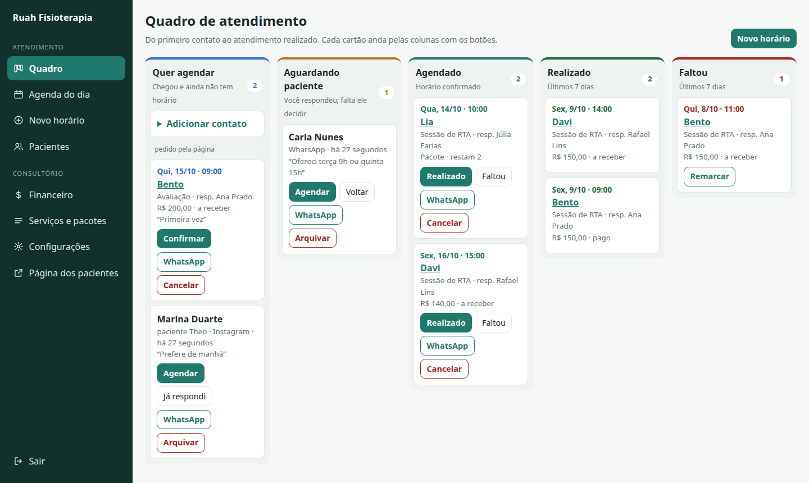
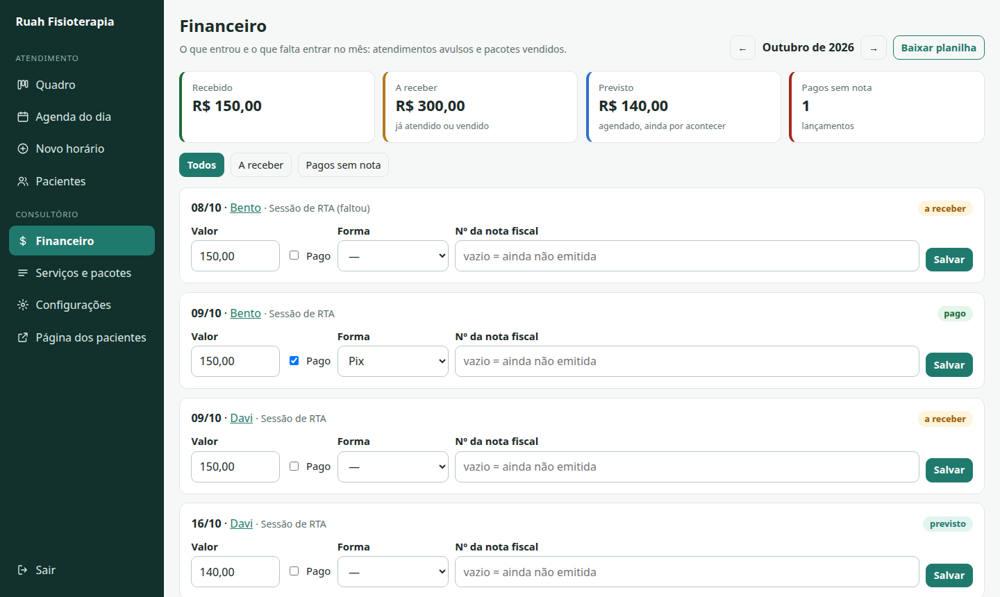

# Ruah

[](https://github.com/Amadeus-22/ruah/actions/workflows/ci.yml)


[](LICENSE)

Scheduling, patient triage and bookkeeping for a physiotherapist who works alone.

*Ruah* (רוּחַ) is the Hebrew word for breath, as in the breath of life of Genesis 2:7.
The practice this was built for does respiratory physiotherapy.



## The problem

A physiotherapist with no receptionist books everything by WhatsApp and Instagram
messages. Requests get lost in chats, the same slot is offered twice, package
sessions are counted from memory, and at the end of the month nobody knows what
was paid or which payments still need an invoice.

Ruah replaces that with three things:

- a **public page** where a patient sees the free slots and requests one;
- a **triage board** that follows each contact from the first message to the session;
- a **finance page** that shows what came in, what is owed and what is still unbilled.

The interface is in Brazilian Portuguese, which is the language of its users.
Code comments that describe business rules are in Portuguese for the same reason.

## Features

| Area | What it does |
|---|---|
| Public booking | Lists services and free slots; a request holds the slot until the professional confirms it. Rate limited, no account needed. |
| Triage board | Five columns: wants to book, waiting for the patient, booked, done, no-show. Cards move with buttons, so it works on a phone. |
| Day agenda | Next eight days, sessions that passed without an outcome, packages about to run out, reminders to send. |
| Reminders | One tap opens WhatsApp with the message written; the reminder then leaves the list. |
| Packages | Sells a block of sessions and deducts them as they are used. Whether a no-show costs a session is a setting. |
| Finance | Received, owed and expected per month; payment method and invoice number per entry; CSV export for the accountant. |
| Phone calendar | A read-only iCalendar feed behind a secret, revocable link, for the phone's calendar app to subscribe to. |
| Availability | Weekly working hours, one-off blocks, buffer between patients, minimum notice, booking horizon. |

<p>
  
  
</p>

## How it is built

Laravel 13 on PHP 8.4, MySQL 8.4, server-rendered Blade and one hand-written
stylesheet. There is no JavaScript build step, on purpose: the app is forms and
lists, and a single maintainer has to keep it running.

```
app/
├── Scheduling/
│   ├── SlotFinder.php   pure function: working hours − appointments − blocks → free slots
│   ├── Schedule.php     loads the data for a day and asks SlotFinder
│   └── Booking.php      the appointment lifecycle and the package session count
├── Calendar/
│   ├── IcsFeed.php          renders the subscription feed (RFC 5545)
│   └── CalendarGateway.php  port for a two-way calendar sync; NullCalendar today
├── Http/Controllers/    thin: validate, call Scheduling, redirect
└── Models/              Eloquent models, no business rules
```

### Decisions worth knowing

- **The slot rule is a pure function.** `SlotFinder` receives durations, windows,
  busy intervals and "now", and returns start times. It reads neither the
  database nor the clock, so its edge cases (buffers on both sides of a session,
  minimum notice, split working hours) are covered by fast unit tests.
- **Double booking is prevented at the write.** `Booking::book` takes a cache
  lock, checks the slot again inside it and only then inserts. Two people
  tapping the same slot get one appointment and one clear error.
- **A request holds the slot.** An unconfirmed request already blocks the time,
  so the professional never has to turn down a patient she was shown as free.
- **Money is integer cents.** Parsing and formatting of `R$ 1.234,56` live in one
  place (`App\Support\Money`).
- **A package is paid once.** Sessions taken from a package are not finance
  entries; the sale of the package is. That keeps monthly totals from counting
  the same money twice.
- **No clinical data.** The system stores names, a phone number and
  appointments. It has no field for diagnosis or progress notes, and the public
  form says so. That keeps it out of the scope of a medical record under LGPD,
  the Brazilian data protection law.
- **Calendar sync is behind an interface.** Publishing to the phone is done
  (the feed). Reading the phone's calendar back needs credentials the owner has
  to provide, so `CalendarGateway` is the seam where it will plug in.

## Running locally

Requirements: PHP 8.4 with `pdo_mysql`, Composer and Docker.

```sh
docker compose up -d --wait          # MySQL on 127.0.0.1:3307
composer setup                       # install, .env, app key, migrate, seed
php artisan db:seed --class=DemoSeeder   # optional: fictional patients and sessions
php artisan serve --port=8010
```

- Public page: <http://localhost:8010>
- Panel: <http://localhost:8010/painel>, user `fisio@local.test`, password `trocar-esta-senha`

The seeded user, services and prices are examples for local use. Change the
password before exposing the app anywhere.

## Tests

```sh
composer test     # PHPUnit against the ruah_test database created by Docker
composer lint     # Laravel Pint, check only
```

The suite covers the slot rule on its own and the flows end to end: public
request, confirmation, package deduction, no-show, the board, finance totals,
the calendar feed and reminders. CI runs both commands on every push.

## Roadmap

- Read the phone's calendar (iCloud over CalDAV) so personal events block slots.
- Notify the professional when a request arrives.
- Create board cards from incoming WhatsApp messages (needs the official API).
- Issue the service invoice (NFS-e) from the finance page instead of recording its number.
- Deployment: container image, backups and a hosting guide.

## License

[MIT](LICENSE)
